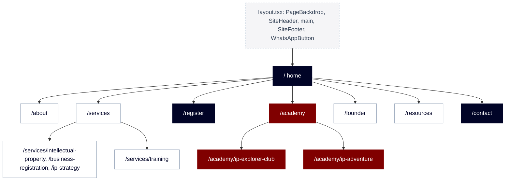

# DVIPC: marketing site

The public site for **DanVick Intellectual Property Consult (DVIPC)**, a
Nigeria-based intellectual property consulting and advisory firm, and its
educational arm, **DVIPC Academy**. It is a multi-page site whose routes follow
the brief's recommended architecture (section 4.1).

The content comes from the **DVIPC website content brief**, kept in
[`docs/BRIEF.md`](docs/BRIEF.md). The brief tags every item **[CONFIRMED]**,
**[IMPLIED]** or **[MISSING]**, and the site follows those tags strictly (see
"Where the copy comes from" and "Known gaps").

> **Read [`AGENTS.md`](AGENTS.md) before writing code.** This is Next.js **16**,
> whose APIs and conventions differ from older versions. The guides in
> `node_modules/next/dist/docs/` are the authority, not memory or older tutorials.
>
> That file also carries the short list of **project rules**. This README is the
> reasoning behind them.

---

## Stack

| Concern | Choice | Notes |
| --- | --- | --- |
| Framework | Next.js 16.3.1, App Router | Turbopack; the homepage prerenders static |
| UI | React 19.2 | pages are Server Components; animated sections are client components (`"use client"`) |
| Styling | Tailwind CSS v4 | CSS-first config in [`globals.css`](src/app/globals.css): there is **no** `tailwind.config.js` |
| Animation | framer-motion 13 | scroll reveals, service tabs, the FAQ accordion, the mobile menu; the hero rotation is CSS transitions |
| Icons | `@hugeicons/react` + `@hugeicons/core-free-icons` | |
| Fonts | Cormorant Garamond 500/600 + italic (headlines), Poppins 400 to 700 (body, labels) | via `next/font/google` |

`shadcn` and `tw-animate-css` are pulled in by `globals.css` for their token
vocabulary and utilities only: no shadcn component is rendered.

## Quick start

Requires **Node ≥ 20.9**.

```bash
npm install
npm run dev      # http://localhost:3000
npm run build    # production build: run this before every commit
npm run lint     # eslint
```

---

## Routes

Every route prerenders static. The page list lives in
[`src/lib/nav.ts`](src/lib/nav.ts) and drives the header and footer.

| Route | Brief key message | Built from |
| --- | --- | --- |
| `/` | Protect innovation, preserve creativity, empower growth | `Hero`, `HomeSections` teasers, `CtaSection` |
| `/about` | A consulting and educational IP organization with a grassroots mission | `AboutSection`, `AudiencesSection` |
| `/services` | The four service categories (addendum) | category index from `src/lib/services.ts` |
| `/services/intellectual-property` | Trademarks, patents, copyright, industrial designs | `ServiceTabs` + `IP_REGISTRATION` |
| `/services/business-registration` | CAC pre- and post-incorporation, structuring | `ServiceTabs` + `CAC` |
| `/services/ip-strategy` | Portfolio, trade secrets, commercialization, policy advisory | `ServiceTabs` + `IP_STRATEGY` |
| `/services/training` | Institutional and professional IP learning | `content.tsx` blocks |
| `/academy` | IP knowledge accessible to everyone | `AcademySection`, `InitiativesSection` |
| `/academy/ip-explorer-club` | Introducing IP education to schools and young innovators | `content.tsx` blocks |
| `/academy/ip-adventure` | Learning IP through stories and creativity | `content.tsx` blocks |
| `/founder` | The expertise, experience and vision behind DVIPC | `FounderSection asPage` |
| `/resources` | Educational content, publications and case reviews | `ResourcesSection` |
| `/contact` | Connect with DVIPC for consultation, training, or partnership | enquiry list, contact details, `FaqSection` |
| `/register` | Registration for a service or programme | `RegisterForm` (composes an email; no backend) |

`/commercialization` and `/training` permanently redirect to their new
addresses under `/services` (see `next.config.ts`).

The brief's **Blog** page is not built: no articles exist yet.



Every inner page opens with `PageHero` (navy, breadcrumb, `h1`) and, apart
from `/contact`, closes with `CtaSection`. Every call to action that asks for
contact goes to `/contact`.

### Where the copy comes from

| Section | Brief source |
| --- | --- |
| Home hero | 4.3, word for word |
| About | 1.1 to 1.4, 3.3, positioning summary |
| Services | the 18 November addendum (`src/lib/services.ts`); CTAs from 4.11 |
| Who we help | 3.1, 3.2, 4.11 |
| Academy | 2.1 |
| Initiatives | 4.7, 4.8, the Summer School features in 2.1 |
| Founder | 4.9, 5.1 |
| Resources | 5.3, 2.3, 4.10 |
| IP strategy | addendum categories 5 to 7; policy advisory from 2.2 I |
| Training | 2.2 H, 2.1 |
| IP Explorer Club | 4.7 |
| IP Adventure | 4.8, 5.3 |
| Contact | 4.11; FAQ assembled only from the above |

Rules applied:

- **[IMPLIED]** services (industrial design registration, trade secret advisory)
  are worded as *expertise*, not as offers. Policy and trade work is presented
  as expertise, apart from the commercial services, as the brief asks.
- The implied trademark **process** (brief 2.2 A) is not shown: the brief says
  the workflow and commitments need confirming.
- **No statistics section.** The brief says to use only verified, current
  numbers; none are verified yet.
- **No testimonials, team or partner logos**: the brief marks them missing, and
  the earlier drafts' ones were fictional.

---

## How the header knows what colour to be

Each section advertises its own tone, and the header samples whichever section
is under a fixed probe line (`PROBE_Y`). **Any new section must declare both
attributes**:

```tsx
<section
  id="my-section"
  data-nav-tone="dark"
  data-nav-bg="var(--color-brand-navy)"
  className="relative bg-brand-navy py-24 text-white md:py-32"
>
```

The header lives in the root layout, so it re-probes on every navigation as
well as on scroll. It starts dark, because every page opens on a navy band.

---

## Design system

Tokens live in [`globals.css`](src/app/globals.css). The palette is sampled
from the logo artwork. **Light theme only.**

| Token | Value | Use |
| --- | --- | --- |
| `brand-maroon` / `--brand` | `#800000` | "DV" in the logo: CTAs, accents, the Academy band. White on it is 10.4:1 |
| `brand-navy` | `#010427` | "IPC" in the logo: dark bands, headings (`--ink`) |
| `brand-rose` | `#F2B8B8` | accent words on navy (12:1) and maroon (6.4:1). Never on white |
| `brand-blush` | `#F8E9E9` | tinted fills on white |
| `--soft` | `#5B6070` | body copy on white (6.4:1) |

Utilities:

- `heading-xl`, `heading-md`: the serif headline sizes. Accent words are an
  `<em>` in maroon (light) or rose (dark).
- `btn`: square, tracked-out uppercase button; colours added per use.
- `slash`: the diagonal parallelogram from "DV", the site's one recurring shape.

### Design language

Editorial and law-firm in tone rather than app-like: a Garamond for headlines,
square corners, hairline-ruled lists instead of tiles, numbered folios
(`SectionCaption`), and generous space. The background is
[`ColumnGuides`](src/components/ColumnGuides.tsx): faint vertical hairlines on
the content grid, like the guides of a printed page.

---

## Shared components

| Component | Role |
| --- | --- |
| [`SectionCaption`](src/components/SectionCaption.tsx) | The eyebrow every section opens with: optional serif italic number (homepage teasers only), hairline, label |
| [`PageHero`](src/components/PageHero.tsx) | The navy opening band of every inner page: breadcrumb, eyebrow, `h1`, lead, optional actions |
| [`content.tsx`](src/components/content.tsx) | `PageSection`, `RuledList`, `SlashList`, `Label`, `Actions`: the blocks inner pages are built from |
| [`ServiceTabs`](src/components/ServiceTabs.tsx) | A set of services as WAI-ARIA tabs, fed from `src/lib/services.ts`; each tab's button opens `/register` with that service preselected |
| [`RegisterForm`](src/components/RegisterForm.tsx) | The registration form. Composes an email to `CONTACT.email`; reads `?service=` with `useSyncExternalStore` |
| [`Logo`](src/components/Logo.tsx) | The logo artwork, `mark` (no tagline) or `full`, cross-fading between colour and all-white versions by tone |
| [`PageBackdrop`](src/components/PageBackdrop.tsx) / [`ColumnGuides`](src/components/ColumnGuides.tsx) | The page-wide ground |
| [`SiteHeader`](src/components/SiteHeader.tsx) | Full-width bar, filled with the ground beneath it; highlights the current page (`isActive` in `nav.ts`) |
| [`WhatsAppButton`](src/components/WhatsAppButton.tsx) | Fixed WhatsApp link. Renders nothing until `CONTACT.whatsapp` is set |
| [`src/lib/site.ts`](src/lib/site.ts) | Name, tagline and **every contact detail**. Fill a field in and it appears in the footer and WhatsApp button |

### Patterns worth copying

- **Scroll reveal.** Sections define a local `reveal(delay)` gated on
  `useInView(ref, { once: true })`, with `ease = [0.22, 1, 0.36, 1]`.
- **Rotating hero without layout shift.** All slides share one grid cell
  (`[grid-area:1/1]`); the outgoing slide fades out before the next fades in.
  Rotation pauses on hover and focus, has a stop button, and is off under
  `prefers-reduced-motion`.
- **Tabs.** The services tabs are WAI-ARIA tabs, vertical on desktop and a
  sideways-scrolling row on phones; all four arrow keys move between them.
- **No `setState` inside an effect body.** Use `useSyncExternalStore` for a
  hydration-time value (see `SiteFooter`, `Hero`).

---

## Checking it in a browser

Most sections reveal on scroll, so a plain headless screenshot captures empty
sections. Drive Chrome over the DevTools protocol: `npm run build`,
`npx next start`, launch Chrome with `--remote-debugging-port`, set the viewport
with `Emulation.setDeviceMetricsOverride`, scroll the page in steps so every
reveal fires, then `Page.captureScreenshot` with `captureBeyondViewport`. Check
at 1440 px and 390 px, and compare `scrollWidth` with `innerWidth` for
horizontal overflow. Node 20 needs `--experimental-websocket`.

Stop `next start` before rebuilding. On Windows, stopping the `npx` wrapper can
leave the Node server holding the port: check it is free.

---

## Assets

`public/brand/` holds every image, all WebP:

| File | What |
| --- | --- |
| `dvipc-mark.webp` / `dvipc-mark-white.webp` | Logo without the tagline (header) |
| `dvipc-logo.webp` / `dvipc-logo-white.webp` | Full lockup (footer) |
| `dvipc-icon.webp` | Favicon, 256 px |
| `founder.webp` | Founder corporate portrait, 896 × 1120 |

The logo was delivered as a 1080 px JPG on white. The WebPs are cut out with a
colour-to-alpha pass (so anti-aliased edges survive on any ground), cropped to
their bounding box, clear of two stray specks in the master. The masters live
**outside the repo**, in `../dvipc-assets/`. An SVG or transparent PNG of the
logo from the designer would be sharper: swap it in if one exists.

Rules:

- **Keep originals out of `public/`.** Everything there ships.
- **Check the file signature, not the extension.**
- **`sizes` must match the real rendered width.**
- **Flatten anything that must be opaque.**

---

## Known gaps

Each is a decision for DVIPC. The brief's own gap list (60 questions) is at
the end of [`docs/BRIEF.md`](docs/BRIEF.md).

| Gap | Detail |
| --- | --- |
| Contact details | Phone, email and address are confirmed and live. WhatsApp number, business hours and social links are not: the WhatsApp button stays hidden |
| Addendum open questions | CAC scope (business names and LLCs), PSC and beneficial-ownership filings, industrial design filing versus advisory, valuation services versus advisory. The site uses the addendum's cautious wording until answered |
| Registration form | Composes an email; nothing is stored. A real backend, a privacy notice and spam protection are needed before collecting data on the server |
| Founder portrait | The new corporate portrait (`founder.webp`) is assumed to be the founder: confirm |
| Brand spelling | The logo says "DanVick", the brief "Danvick" (gap A1). The site follows the logo |
| Domain | Not confirmed; no metadata base URL is set |
| Services | Which services are offered directly, in which jurisdictions, and whether industrial designs and trade secrets are offered as services (gaps B8 to B12, B18) |
| Pricing | None shown; the FAQ does not answer cost (gaps B13 to B15) |
| Academy | No catalogue, fees, dates or registration links (gaps C19 to C27). Programme CTAs are enquiries |
| IP Adventure | No purchase link, price or editions (gaps D33 to D36) |
| Founder | Approved biography and memberships (gaps E37 to E40). The section lists only confirmed credentials |
| Impact numbers | None verified, so none shown (gaps F44 to F48) |
| Testimonials, team, partners | None supplied with permission (gaps F49 to F52, E42) |
| Privacy policy | Needed before any contact or enrolment form collects data |
| Blog | The brief's Blog page is not built until there are articles to publish |
